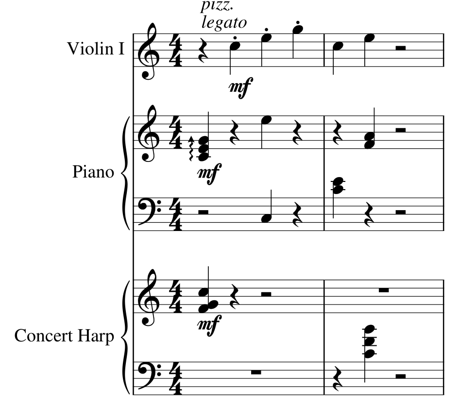

# midi2dorico

[](https://github.com/chidanatsukijp/midi2dorico/actions/workflows/tests.yml)
[](LICENSE)

**Turn a multi-track orchestral DAW MIDI into a Dorico-ready MusicXML full score.**

Not a format converter — an *editorial layer* that makes the engraving decisions you
would otherwise fix by hand for hours: quantization, voice splitting, rest spelling,
transposition, percussion kits, glissandi, playing techniques and dynamics.



---

## Why another MIDI → MusicXML tool?

Most converters (`music21`, MuseScore/Finale/Sibelius MIDI import, small one-off scripts)
do the same thing: quantize everything onto one grid, put each track in one voice, fill
the holes with rests and hope for the best. The score imports — and then you spend the
evening deleting 16th rests and splitting drum voices.

`midi2dorico` treats the conversion as a series of **measurable editorial decisions**:

| Decision | How it is made |
|---|---|
| Rhythm | 16th grid + isolated-16th alignment + tuplets for micro-runs (3/5/6/7/9/10/11) |
| Rests | "Ineffective rests" merged into longer values; never crosses the bar midpoint; half rests only on beats 1–2 |
| Voices | Two voices per staff when a moving line sits over a held note |
| Percussion | Hands (up-stem) vs feet (down-stem), per-pitch noteheads, `score-instrument`, no ties |
| Transposition | Written pitch + correct `diatonic` / `chromatic` / `octave-change` split |
| Techniques | Program changes and keyswitch pitches → `pizz.` `arco` `trem.` `Glissando` |
| Dynamics | Velocity, smoothed and only where the level actually holds |
| Grand staff | Viterbi split for piano/harp, 7-pedal solver for the harp, glissando detection |

Everything is verified: **XSD validation**, a **notation rule audit (R1–R7)**, a
**fidelity audit against the original MIDI**, and a **regression suite**.

## Install

```bash
pip install -r requirements.txt          # core: mido, pydantic, lxml
pip install -r requirements-render.txt   # optional: PDF preview (verovio, pymupdf, reportlab, svglib)
```

The core install is enough to convert scores and to run the regression suite; the
render requirements are only needed by `render_pdf.py`, `render_musicxml.py` and
`preview_part.py`.

## Quick start

```bash
# 1) Inspect the tracks (optional diagnostic)
python midi_inspector.py --input your_score.mid --output manifest.json

# 2) Convert with automatic instrument detection
python main.py --input your_score.mid --output score.musicxml

# 3) Convert with an explicit engraving config (recommended)
python main.py --input your_score.mid --config engraving_config.json --output score.musicxml

# 4) Render a PDF preview
python render_pdf.py score.musicxml score.pdf a4 45
```

Then **File → Import → MusicXML** in Dorico.

Try it without your own MIDI:

```bash
python test_generator.py     # writes test_orchestra.mid + engraving_config.json
python main.py --input test_orchestra.mid --config engraving_config.json --output out.musicxml
```

## How it works

```
MIDI ──▶ inspect (manifest) ──▶ merge tracks ──▶ clean/quantize ──▶ engrave ──▶ audit ──▶ render
         midi_inspector          merge_groups     timing_cleaner    xml_exporter   audit_*   render_pdf
```

1. **Inspect** — every note below the instrument's playable range is a candidate
   keyswitch, and a consistent negative onset offset is a VST pre-delay.
2. **Merge** — tracks sharing a `merge_group_id` are folded into one unit *before*
   clean-up, so the rest/staccato logic sees the whole musical line.
3. **Clean** — compensate VST delay, collapse rolled chords into `arpeggiate`, detect
   micro-runs and glissandi, quantize, dedupe unisons, make rests readable.
4. **Engrave** — split grand staves (Viterbi), solve harp pedals, assign voices, spell
   pitches, write transpositions, dynamics and technique texts.
5. **Audit** — XSD, notation rules, fidelity to the source MIDI.

## Configuration

`config_schema.py` defines the Pydantic model `ScoreEngravingConfig`; every option can
also be set by hand in JSON. Without a config file the pipeline builds one from the
track names.

### Score-level options

| Key | Meaning |
|---|---|
| `title` | Work title written to `<work-title>` |
| `score_order` | `track` keeps DAW order; `standard` sorts by orchestral family |
| `rest_style` | `standard` (engraving rules) or `merged` (fewest rest symbols) |
| `quantize_grid_beats` | Base grid, default `0.25` (16th note) |
| `arpeggio_window_min_beats` / `_max_beats` | Onset spread that counts as a rolled chord (`0.03`–`0.15`) |
| `max_overlap_trim_beats` | Longest legato tail overlap to clip (`0.5`) |
| `glissando_max_step_semitones` | Largest step allowed inside a glissando sweep (`24` keeps chord sweeps) |
| `program_techniques` | Program number → technique text, e.g. `{"45": "pizz.", "44": "trem."}` |
| `keyswitch_map` | Default keyswitch pitch → technique table (see below) |

### Track-level options

| Key | Meaning |
|---|---|
| `track_index` | 0-based MIDI track index |
| `part_name` | Name shown in Dorico |
| `instrument_type` | `strings` / `winds` / `brass` / `piano` / `harp` / `percussion` / `other` |
| `min_playable_pitch` | Notes below this pitch are treated as keyswitches |
| `keyswitch_map` | Per-track keyswitch pitch → technique override |
| `merge_group_id` | Tracks sharing it are merged into one part **before** clean-up |
| `transpose_semitones` | Written-pitch transposition (Horn in F `+7`, Trumpet in Bb `+2`) |
| `pitch_remap` | Remap VST trigger pitches to real pitches (timpani `{"0": 38, "1": 45}`) |
| `unpitched` / `staff_lines` | Unpitched percussion notation and staff lines (1 = single line, 5 = kit) |
| `auto_vst_delay_compensation` / `manual_delay_offset_beats` | Automatic or manual pre-delay compensation |

### `keyswitch_map` precedence

| Level | Where | Effect |
|---|---|---|
| 1 | track `keyswitch_map` | overrides that track, e.g. harp `{"2": "Glissando"}` |
| 2 | score `keyswitch_map` | default table for the whole score (C0 = 24 layout) |
| 3 | `{}` | disable automatic mapping entirely |

A sub-range note that matches no mapping is dropped as a silent trigger.

## Regression tests

```bash
python regression_test.py
```

```
unit tests
  PASS  classify_track                    [14 names]
  PASS  <transpose> octaves               [5 instruments]
  PASS  tuplet ratios                     [11 counts]
  PASS  two voices per staff              [held + moving line]
  PASS  merge before cleanup              [2 tracks -> 1 part]
  PASS  keyswitch map is configurable     [4 precedence cases]
integration
  PASS  end-to-end scores                 [self-test:3pt/2m]

7/7 checks passed
```

The integration stage checks every generated score for schema validity, measure sums,
tie balance and the R1–R7 notation rules. Scores whose MIDI/config are absent are
skipped, so a fresh clone only needs the built-in test material.

## Tools

| Command | What it does |
|---|---|
| `python audit_notation.py score.musicxml` | Engraving rules R1–R7; exits non-zero when a rule is broken |
| `python audit_fidelity.py input.mid config.json` | Onset/duration fidelity against the source MIDI |
| `python render_pdf.py score.musicxml score.pdf a4 45` | Multi-page PDF preview |
| `python render_musicxml.py score.musicxml page.png` | Single-page PNG preview |
| `python preview_part.py score.musicxml "Violin I" 1 8` | Render one part, measures 1–8, to PNG |
| `python main.py --interactive ...` | Ask per track what the names, transpositions and keyswitches mean, then convert |

The rendering helpers need the optional dependencies:
`pip install -r requirements-render.txt`.

## Limitations

- **No slurs.** Phrase slurs are left to the arranger (automatic detection is noisy).
- No hairpins or accents: MIDI has no CC11 expression, so those would be guesswork.
- Accidentals use a static sharp/flat table (not key-aware).
- Percussion is fixed to two voices (hands/feet).
- The PDF preview is Verovio, one system per page; the final layout comes from Dorico.

## License

MIT — see [LICENSE](LICENSE).
